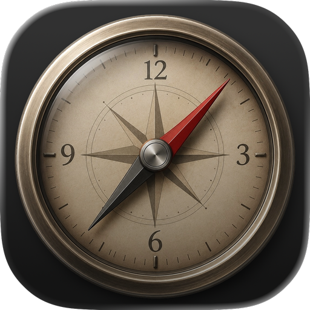
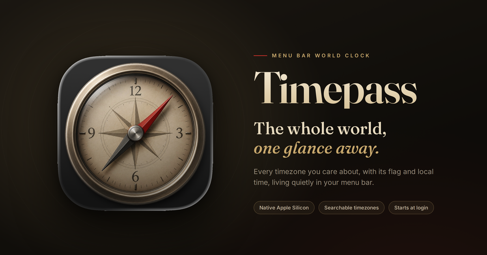
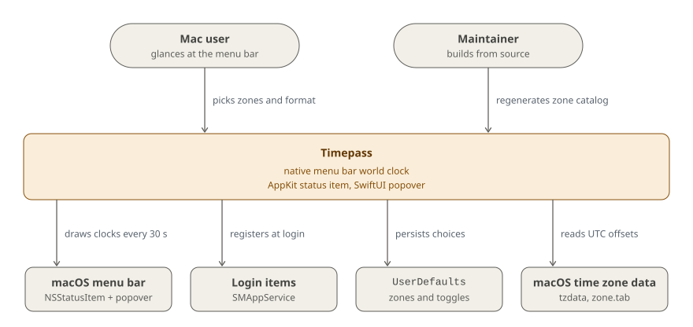

# Timepass

**Every timezone you care about, with its flag and local time, in your Mac's menu bar. Native on Apple Silicon.**


<br clear="left">

[**Website**](https://timepass.guillermorodas.com/) · [Build from source](#quick-start) · [How it works](#how-it-works) · [Architecture](#architecture) · [Contributing](#contributing)



*The whole world, one glance away.* Native Apple Silicon · Searchable timezones · Starts at login.

## Why

Timepass replaces older world-clock menu bar utilities that never made the jump to Apple Silicon. [Flagtimes](https://www.flagtimes.com/), which inspired it, runs on Apple Silicon Macs only through Rosetta 2, and Apple is retiring Rosetta after macOS 27. Timepass is a native alternative that keeps working.

It's for anyone who works across timezones and wants the answer in the menu bar: add as many zones as you like, each shown as its country flag and local time. No windows to open, no Dock icon. It's not a calendar, a meeting planner or a timezone converter: it shows the time, and that's it.


**Features**

- Searchable country/timezone picker, typo-tolerant ("new yrok" still finds New York)
- Multiple flag + time entries in the menu bar
- AM/PM, Show Date, Show Day toggles
- Start at Login (modern `SMAppService`)

### Design principles

| Principle | In practice |
|---|---|
| **Native, not ported** | Pure AppKit `NSStatusItem` for the menu bar item, SwiftUI hosted in an `NSPopover` for the picker. No Electron, no Chromium. |
| **Out of the way** | `LSUIElement=true`: no Dock icon, no windows. The popover closes on any outside click. |
| **Nearly idle** | One 30 s timer (with tolerance) redraws the title; otherwise the app only reacts to your changes. |
| **The OS is the source of truth** | Countries and zones come from macOS's own tzdata; flags are Unicode emoji; times are computed by `TimeZone`/`DateFormatter`. No network calls. |

## Quick start

You need **macOS 13.0+ (Ventura)**, **full Xcode 15+** (Command Line Tools alone are not enough) and [XcodeGen](https://github.com/yonaskolb/XcodeGen).

```sh
sudo xcode-select -s /Applications/Xcode.app/Contents/Developer   # once, after installing Xcode
brew install xcodegen                                              # first time only

git clone https://github.com/glrodasz/timepass.git && cd timepass
make install && make run      # Release build, copy Timepass.app into /Applications, launch it
```

First launch: right-click `Timepass.app` → **Open** (Gatekeeper accepts unsigned builds with explicit consent). Then click the clock in the menu bar to add zones.

<details>
<summary>All <code>make</code> targets and working in Xcode</summary>

`make help` lists every target:

```sh
make generate   # regenerate Timepass.xcodeproj from project.yml
make build      # Release build into build/DerivedData
make install    # build, then copy Timepass.app into /Applications
make run        # launch the installed app
make catalog    # regenerate the timezone catalog
make clean      # remove build/ and Timepass.xcodeproj
```

To work in Xcode instead:

```sh
make generate
open Timepass.xcodeproj       # ⌘R in Xcode
```

</details>

## How it works

| Step | What happens |
|---|---|
| **Launch** | `main.swift` starts `NSApplication` as an accessory app and wires `AppDelegate`. On first launch, `ZoneStore` seeds your local timezone so the bar shows a flag and time right away. |
| **Menu bar title** | `AppDelegate` joins one `flag time` entry per enabled zone. It redraws every 30 s and whenever the zone list or a preference changes. With no zones, it shows 🌐. |
| **Picker** | Clicking the item opens a SwiftUI popover: a search field, the country list (single-zone countries toggle directly, multi-zone countries expand to their zones) and an **All / Enabled** switch. |
| **Search** | `TimeZoneCatalog` matches country names, ISO codes and zone identifiers word by word ("new york", "united states york"), plus a few aliases (`usa`, `uk`, `uae`). When nothing starts with your query, `FuzzySearch` falls back to mid-word and typo-tolerant matches. |
| **Preferences** | The gear menu toggles AM/PM (24-hour by default), Show Date, Show Day and Start at Login. |
| **Persistence** | Enabled zones and toggles live in `UserDefaults`; nothing leaves your Mac. |

### macOS 26 notes

macOS 26 changed how status items are placed, and Timepass works around it in two ways.

**The status item carries an empty 1×1 image** (`AppDelegate.applicationDidFinishLaunching`). On macOS 26, title-only `NSStatusItem`s are sometimes placed inside the system-icons slot (right of the Control Center pill) instead of the third-party status zone, where they render invisibly behind battery/wifi/clock. Setting an image — even a transparent one — anchors the item in the correct zone.

There is no SwiftUI `App`/`Settings` scene either: that wrapper turns `NSStatusItem` into `NSSceneStatusItem` and triggers placement bugs on macOS 26.

If the menu bar icon ever vanishes after a clean reinstall, a stuck Control Center slot cached against the bundle id can be the cause; adding a temporary suffix to `PRODUCT_BUNDLE_IDENTIFIER` in `project.yml` forces a fresh slot.

## Architecture

Timepass is one small app that talks only to macOS.

<picture>
  <source media="(prefers-color-scheme: dark)" srcset=".github/readme/diagrams/context-dark.svg">
  
</picture>

Everything outside the amber box is macOS itself; Timepass has no server, account or network dependency. The zone list is a JSON catalog generated from `/usr/share/zoneinfo/zone.tab` at build time and bundled with the app, while the current offset of each zone (including daylight saving) is computed at runtime by the system's `TimeZone`.

**Tech stack:** Swift 5.9 · AppKit (`NSStatusItem`, `NSPopover`) · SwiftUI · Combine · ServiceManagement (`SMAppService`) · XcodeGen + Make · static HTML landing page on GitHub Pages.

## Usage and configuration

| Setting | Where | Default |
|---|---|---|
| Zones shown in the bar | Popover: toggle a country or check a zone | Your local zone |
| AM/PM | Gear menu → AM/PM | Off (24-hour) |
| Date / weekday | Gear menu → Show Date, Show Day | Off |
| Start at Login | Gear menu → Start at Login | Off |
| Quit | Gear menu → Quit Timepass (⌘Q) | |

### Project layout

| File | Role |
|---|---|
| `Sources/main.swift` | Pure-AppKit entry point: `NSApplication.shared.run()` after wiring `AppDelegate`. |
| `Sources/AppDelegate.swift` | Owns the `NSStatusItem`, a 30 s `Timer`, the lazy `NSPopover`, and the three `ObservableObject`s. Updates the menu bar title on timer ticks and on `objectWillChange` from `ZoneStore` / `PreferencesStore`. |
| `Sources/ZoneStore.swift` | Persisted list of enabled zone identifiers (UserDefaults). Seeds the local zone on first launch. |
| `Sources/TimeZoneCatalog.swift` | Loads `Resources/timezone_catalog.json`, maps IANA zone → ISO 3166-1 alpha-2, powers picker search. |
| `Sources/FuzzySearch.swift` | Word-based, typo-tolerant matching for the picker. |
| `Sources/TimeZonePickerView.swift` | SwiftUI picker shown inside the popover. |
| `Sources/PreferencesStore.swift` | `@AppStorage` toggles for AM/PM, date, weekday. |
| `Sources/PreferencesView.swift` | SwiftUI menu shown via the gear button in the picker footer. |
| `Sources/LoginItemService.swift` | `SMAppService` wrapper for "start at login". |
| `Sources/ClockFormatter.swift` | Cached `DateFormatter`s for the menu bar title. |
| `Sources/FlagEmoji.swift` | ISO alpha-2 → Unicode flag emoji. |
| `Resources/Info.plist` | `LSUIElement=true` (no Dock icon). |
| `Resources/timezone_catalog.json` | Generated catalog of countries → IANA zones. |
| `Scripts/generate_catalog.sh` | Regenerator for the catalog. |
| `project.yml` | XcodeGen config — single source of truth. |
| `docs/` | The landing page served at [timepass.guillermorodas.com](https://timepass.guillermorodas.com/). |

### Regenerating the timezone catalog

`Resources/timezone_catalog.json` is derived from macOS's bundled tzdata. Re-run only when you bump tzdata:

```sh
make catalog    # same as ./Scripts/generate_catalog.sh
```

### Landing page

The project website is a single static page in `docs/` (no build step). Preview it locally with `python3 -m http.server -d docs`, and publish it via **Settings → Pages → Deploy from a branch → `main` / `/docs`**. The custom domain `timepass.guillermorodas.com` is set by `docs/CNAME` and needs a DNS `CNAME` record `timepass` → `glrodasz.github.io`.

## Documentation

| Doc | What's in it |
|---|---|
| [Website](https://timepass.guillermorodas.com/) | What Timepass is, an interactive picker demo, and build-from-source steps |
| [`docs/index.html`](docs/index.html) | Source of the landing page (single static file) |
| [`project.yml`](project.yml) | Build settings: deployment target, Swift version, bundle id, Info.plist keys |
| [`Makefile`](Makefile) | Every build, install and catalog target (`make help`) |

## Contributing

Issues and pull requests are welcome. The common changes:

- **A new or changed timezone** comes from tzdata, not from hand edits: run `make catalog` on a Mac with updated tzdata and commit `Resources/timezone_catalog.json`.
- **A search alias** (like `uk` for the United Kingdom) goes in the `aliases` table in `Sources/TimeZoneCatalog.swift`.
- **Anything else**: keep the app pure AppKit at the entry point (no SwiftUI `App` scene, see [macOS 26 notes](#macos-26-notes)).

Validate with `make build` (or `make install && make run` to try it), and mention in the PR which macOS version you tested on.

## License

© 2026 Guillermo Rodas. All rights reserved.

Inspired by [Flagtimes](https://www.flagtimes.com/) by [Piérre Reimertz](https://x.com/reimertz). Timezone data comes from the IANA tz database bundled with macOS; flags are Unicode emoji.
